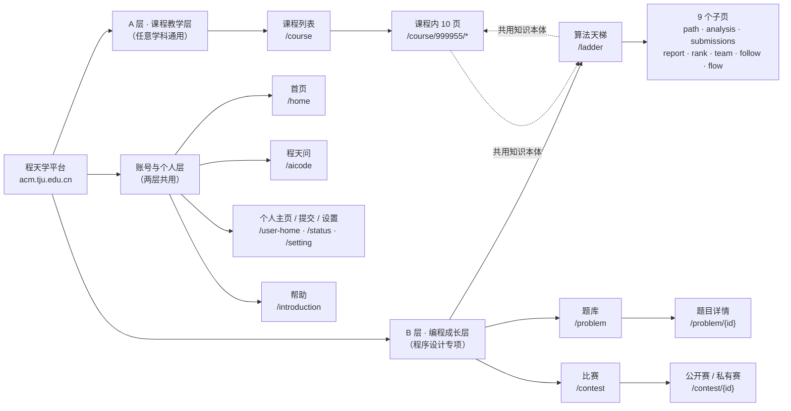

# 程天学（acm.tju.edu.cn）软件功能架构图

> 这是一份**外部站点的功能架构调研**（证据留存），不是本仓的规格或契约。
> 取数方式：Playwright 无头浏览器 + 保留登录态（`storage_state.json`）+ 43 页逐页截图，
> 86 张 PNG / 40516 字符正文 / HTTP 全部 200。证据文件在仓外
> `D:/repo/_tools/acm/`（`analysis/_evidence.jsonl` 43 条逐页原始读数）。
> 为什么放在这里：它是「把 OpenMAIC 搬进 DSH」那个任务的**设计输入** ——
> 程天学把「学生学习状态管理」做成了体系（掌握度四分类 / 学习路线 / ZPD 推荐 /
> 心流 ZONE / 19 阶段闯关 / 天梯分与能力雷达 / 周报），而 OpenMAIC 目前只有
> `lib/quiz/attempt-fold.ts` 把答题记录折成一段文本。

---

> 实测时间：2026-10-31 · 实测账号：同学甲（学号 3026XXXXXX，某大学计算机科学与技术学院，**学生视角**）
> 实测方式：Playwright + 无头 msedge，携带已保存登录态（17 cookies + localStorage），全站 **43 个页面**逐页打开、截图、抓 `inner_text`
> 证据：`D:/repo/_tools/acm/shots/` 下 **86 张**截图（43 页 × full/top）+ `D:/repo/_tools/acm/analysis/_evidence.jsonl` **43 条**记录，正文合计 40516 字符，HTTP **全部 200**。**本文档中每一个功能点都有对应截图；没截到的不写。**

---

## §0 站点定位与角色划分

### 0.1 一句话定位

**程天学是某大学打造的「AI 原生」智慧教学平台**——面向各个学科课程的教、学、练、评一体化系统，一头连着课堂、一头连着课后学习，中间站着一位随叫随到的 AI 助教「程天问」；对程序设计类课程还额外叠加了在线判题、全网 9 大 OJ 题库索引和「算法天梯」成长系统。

原文自述（`/introduction`）：*「程天学是某大学打造的『AI 原生』智慧教学平台，服务于各个学科的课程……课程里可以出单选、多选、判断、填空、简答、编程六种题，客观题自动判分，简答题由 AI 评分；上传课件就能生成知识图谱、让 AI 出题。程序设计类课程还额外拥有在线判题、全网 OJ 题库和算法天梯。」*
页脚署名：`Copyright © 2025–2030 某大学智能信息处理团队 · 程天学 · Powered by HOJ`。

### 0.2 站点是「两层结构」

这是理解整站的关键——**同一个平台上有两套并行的功能体系**，它们共用账号、共用知识点体系（130 个 Codeforces 标签），但入口和数据互相独立：

| 层 | 服务对象 | 入口 | 核心资产 |
|---|---|---|---|
| **A. 课程教学层**（任意学科） | 修课的学生 / 授课教师 | 顶部「课程」`/course` | 课程、预习、课堂、作业、考试、资源、讨论、成绩、学情 |
| **B. 编程成长层**（程序设计专项） | 编程学习者 / 竞赛选手 | 顶部「题库」`/problem`、`/contest`、`/ladder` | 78684 道全网题、天梯分、心流刷题、学习闯关 19 阶段 |

两层在首页 `/home` 汇合：左侧是 B 层的「程序设计图谱 + 算法天梯 + 近期比赛」，右侧是 A 层的「待完成任务 + 课程动态 + 我的课程」。截图 `01-home-full.png` 能直接看到这个左右分栏。

### 0.3 角色划分（实测边界）

本站**没有显式的角色切换 UI**，角色由账号身份决定（帮助页原文：*「天大统一认证：一键登录，姓名、学院自动同步，**6 位工号自动识别为教师**」*）。当前账号 8 位学号 → 学生。

| 角色 | 能否进入 | 实测证据 |
|---|---|---|
| **学生**（本账号实测） | ✅ 全部 A 层学习页 + 全部 B 层页面 | **43 页全部 200 OK** |
| **教师 / 助教** | ⛔ **6 个课程管理页被拦**（HTTP 200 + 中文拒绝文案） | `21`–`24`、`71`、`72` 号截图 |
| **管理员** | ⛔ 全站未见管理后台入口；仅帮助页提到管理员有「AI 一键总开关」 | 无截图，**未验证** |

**学生视角下 6 个课程管理页的确切拒绝文案（原文照抄）**：

| 页面 | URL | 页面正文 |
|---|---|---|
| 课程题库 | `/course/999955/question` | `老师暂未开放课程题库` + `返回课堂` |
| 课程成绩 | `/course/999955/grade` | `课程成绩只有本课程的老师和助教能看` |
| 学情 | `/course/999955/analytics` | `学情只有课程老师能看` / `只有课程老师能查看学情` |
| 看板与讲评 | `/course/999955/board` | `看板与讲评只对课程老师开放` + `返回课堂` |
| 课程设置 | `/course/999955/setting` | `课程设置只对课程老师开放` + `返回课程主页` |
| 实时看作答 | `/course/999955/live/{sid}` | 界面完整渲染，但红 toast `只有课程老师可以查看实时作答` |

> **重要观察**：全站**没有任何 HTTP 403**。所有权限拒绝都是 HTTP 200 + 一段中文拒绝文案渲染在页面中央。这意味着「功能存在但对我不可见」与「功能不存在」在 HTTP 层无法区分——必须读正文才能判定。另外两页是**静默重定向**而非拒绝页：`/course/999955/knowledge`（知识图谱）→ 重定向到 `/course/999955/space`；`/course/999955/challenge`（课程闯关）→ 重定向到 `/course/999955/home`。

---

## §1 一级功能模块表

顶部导航实测 7 项（`01-home-top.png`），另有 3 个不从顶部导航进入但属于一级的个人域页面。

| # | 模块名 | URL | 一句话职责 | 主要子页面数 | 截图 |
|---|---|---|---|---|---|
| 1 | **首页** | `/home` | 学生工作台：待办 + 课程动态 + 课程列表 + 程序设计图谱 + 天梯卡片 + 近期比赛 | 1（单页多区块） | `01` |
| 2 | **课程** | `/course` | 教学闭环主容器：一门课从预习到成绩的全部活动 | **10 个课程内页** + 1 列表页（教师侧另有 8 页） | `10`–`26`、`70`–`72` |
| 3 | **题库** | `/problem` | 程序设计专项编程题库：本地判题 + 9 大 OJ 全网索引 | 2（列表 / 题目详情） | `30`–`31` |
| 4 | **比赛** | `/contest` | 本站编程比赛：公开赛 / 私有赛 | 2（列表 / 详情，详情内 5 个 tab） | `32`–`34` |
| 5 | **天梯**（算法天梯） | `/ladder` | 编程成长系统：天梯分 + 心流刷题 + 学习路径 + 能力分析 + 报告 + 排名 | **9 个子页**（8 导航页 + 1 个心流 ZONE 内部页） | `40`–`47`、`58`、`73` |
| 6 | **✨程天问** | `/aicode` | 全站 AI 数字人助手（与课程内程天问相互独立） | 1（单页，左侧历史 + 右侧对话） | `50` |
| 7 | **帮助** | `/introduction` | 平台介绍 + 全站功能使用指南（15 个章节） | 1（长文档，15 节） | `02` |
| 8 | **个人主页** | `/user-home` | 个人数据总览：热力图 + 天梯雷达 + ICPC 潜力 | 1 | `62` |
| 9 | **我的提交** | `/status` | 全站评测记录 | 1 | `63` |
| 10 | **设置** | `/setting` | 账号安全 / 个人资料 / OJ 绑定 / 微信小程序 | **4 个分栏** | `60`–`61`、`74` |

**子页面计数汇总**：一级模块 **10 个**（顶部导航 7 + 头像菜单 3）；二级页面 **43 个**（含 6 个权限拒绝页、2 个 404 内容页；另有 2 处静默 302 落在已截页面、不单独计数）；三级功能点 **151 个**（119 个带 URL + 32 个纯属性行，见 §2 末尾计数表）；截图 **86 张**（43 × full/top）。

**顶部导航的视觉细节**（`01-home-top.png`）：首页 / 课程 / 题库 / 比赛 / 天梯 / ✨程天问（带 ✨ 图标）/ 帮助（带 ? 图标），当前页高亮为蓝色下划线；右上角是**铃铛通知图标 + 头像「同学甲」下拉**。

**头像下拉菜单实测 4 项**（`analysis/profile_menu.json`）：`我的首页` → `/user-home`、`我的提交` → `/status`、`我的设置` → `/setting`、`退出登录`。

> **注意**：「比赛」和「题库」在顶部导航同层，但帮助页明确二者都是「程序设计专项，不学编程可以不用」；而「课程」是任意学科通用。这是 A/B 两层结构在导航上的体现。

---

## §2 分层功能树

> 记号说明：每个功能点后用反引号标该功能**实际所在的页面 URL**。`⛔` = 学生视角不可达（已实测拒绝文案）。`📷` = 有截图。序号对应 `D:/repo/_tools/acm/shots/` 里的截图前缀。

### 2.0 总览图（一到二级）



> A 层 与 B 层**入口独立、数据独立**，但共用同一套「130 个 CF 知识标签 + 158 条关系」本体，并且在首页 `/home` 汇合成一屏（左栏偏 B 层、右栏偏 A 层）。虚线表示的唯一耦合点是知识本体，不是数据。

### 2.1 完整功能树（三到四级）

```
程天学平台 (acm.tju.edu.cn)
│
├─ 1. 首页  /home  📷01
│  ├─ 1.1 轮播 banner（程天问宣传位）                                   /home
│  ├─ 1.2 公告（刷新 / 分页）                                          /home
│  ├─ 1.3 待完成任务（跨课程汇总，显示剩余时间 + 进度 n/m + 去完成）        /home
│  ├─ 1.4 最近课程动态（近 7 天）                                       /home
│  ├─ 1.5 我的课程（学期下拉 + 课程卡片快捷入口）                         /course
│  ├─ 1.6 程序设计图谱（★ 核心可视化）                                  /home
│  │  ├─ 130 个知识标签 · 158 条关系 · 由内向外、由浅入深
│  │  ├─ 关系切换：全部关系 / 学习顺序 / 包含
│  │  ├─ 10 大板块带计数：语言基础 7、基础算法 13、搜索 6、数据结构 27、
│  │  │   动态规划 11、图论 21、数学 25、字符串 9、计算几何 4、综合技巧 7
│  │  ├─ 难度图例：入门 / 熟练 / 进阶 / 高阶
│  │  ├─ 交互：悬停看关系 · 点击选中 · 拖拽平移 · Ctrl+滚轮缩放
│  │  └─ 点击节点 → 跳转到带筛选的编程题库                         /problem
│  ├─ 1.7 算法天梯卡片（新手·800 / 全网 AC / 今日 AC / 连续天数）          /ladder
│  ├─ 1.8 近期比赛（本站比赛 + 外站日历 20+ 条，ATC/CF/牛客/力扣/洛谷徽标）  /contest
│  └─ 1.9 页脚（常用 OJ 外链 6 个 / 公众号 / Bilibili / 语言切换）          /home
│
├─ 2. 课程（教学闭环）  /course  📷10
│  ├─ 2.1 课程列表页  /course  📷10
│  │  ├─ 全部课程 / 我的课程 切换                                       /course
│  │  ├─ 学期筛选 + 搜索（课程名/课程号/学期/老师姓名/学校）              /course
│  │  ├─ 课程卡片（课程名 · 学期 · 人数 · 已加入/凭口令加入/我是老师）      /course
│  │  └─ 新建课程（教师）                                              /course
│  │
│  └─ 2.2 课程内（10 页，学生视角；以「26271-程序设计原理」/ 杜朴风 / 225 人 为样本）
│     ├─ 2.2.1 主页  /course/999955/home  📷11
│     │  ├─ 课程顶栏（课程名 · 学期 · 学校 · 教师 · 人数 · 保护课程徽标）  /course/999955/home
│     │  ├─ 课程动态（自动发布 作业发布…）                               /course/999955/home
│     │  ├─ 待完成任务（含进度条 0/15 + 剩余天数 + 去完成）               /course/999955/home
│     │  ├─ 当前课堂（第 n 次课 / 题目 n 道 / 进入课堂）                  /course/999955/home
│     │  ├─ 课程日历（月视图 / 本周 / 今天 / 已排课/未排期/本月课次）      /course/999955/home
│     │  ├─ 课程简介                                                  /course/999955/home
│     │  ├─ 我的掌握度（★ 见 §4.1）                                    /course/999955/home
│     │  └─ 资源（最近资料 / 暂无资源）                                 /course/999955/resource
│     │
│     ├─ 2.2.2 预习  /course/999955/prep  📷12
│     │  ├─ 预习任务列表（空态「老师还没有发布预习任务」）                /course/999955/prep
│     │  └─ 去预习 → 沉浸式学习页（教师侧按钮：存为草稿/保存并发布/同步到本课程）
│     │
│     ├─ 2.2.3 课堂  /course/999955/class  📷13
│     │  ├─ 当前/历次课堂切换                                         /course/999955/class
│     │  ├─ 我的提交 · 第 n 次课（抽屉）                                /course/999955/class
│     │  ├─ 本节课课程目标 / 当堂资料                                   /course/999955/class
│     │  └─ 当堂题目（题型 · 分值 · 难度 · 全班提交 · 我的状态）           /course/999955/class
│     │
│     ├─ 2.2.4 作业  /course/999955/contest  📷14  （★ 复用 contest 路由）
│     │  ├─ 作业列表（进行中 / 已结束；题数 · 起止时间 · 提交次数 · AC 人数）  /course/999955/contest
│     │  ├─ 未作答 / 去作答 / 题目                                      /course/999955/contest
│     │  └─ 沉浸式作答（独立窗口）  /course/999955/homework/{hid}/practice  📷25
│     │     ├─ 顶栏：作业名 · 进行中 · 距截止 · 已完成 n/m              /course/999955/homework/1400/practice
│     │     ├─ 左侧题号 + 题型 + 状态（编程·A 未作答 …）                 /course/999955/homework/1400/practice
│     │     ├─ 作答区：客观题即选即存；编程题代码框 + 语言切换             /course/999955/homework/1400/practice
│     │     └─ 上一题 / 第 n/m 题 / 立即刷新 / 下一题 / 完成，返回作业    /course/999955/homework/1400/practice
│     │
│     ├─ 2.2.5 考试  /course/999955/exam  📷15
│     │  ├─ 考试列表（状态 · 时间 · 我的成绩；空态「课程考试 0 场」）       /course/999955/exam
│     │  └─ 全屏作答（防作弊，详见 §3.6）  /course/999955/exam/{eid}/practice
│     │
│     ├─ 2.2.6 资源  /course/999955/resource  📷16
│     │  ├─ 课程目录（多级章节 + 知识点）                                /course/999955/resource
│     │  └─ Tabs：全部资料 / 放映记录                                   /course/999955/resource
│     │
│     ├─ 2.2.7 学习空间  /course/999955/space  📷17  （★ 见 §4）
│     │  ├─ 学习概览 / 学习路线 / 知识图谱 三标签页
│     │  ├─ 知识体系完备度（已掌握知识点 ÷ 老师已讲内容）
│     │  ├─ 知识点状态（已掌握 / 薄弱 / 待练习 / 未学习）
│     │  ├─ 知识体系全景（按章节列出每知识点及掌握度）
│     │  ├─ 我的重点 / 我的难点
│     │  ├─ AI 学习建议（生成建议）/ 为你推荐
│     │  └─ 重新分析（增量分析：分析于 HH:MM:SS · 用时 n ms）
│     │
│     ├─ 2.2.8 程天问(课程)  /course/999955/ai  📷18
│     │  ├─ 场景筛选（预习 / 作业 / 课堂等）+ 新对话                     /course/999955/ai
│     │  ├─ 历史记录（左栏）                                           /course/999955/ai
│     │  ├─ 对话区（数字人 · 清空对话 · 语音播报 · 我的纠错）             /course/999955/ai
│     │  ├─ 同学们常问（4 条示例）                                      /course/999955/ai
│     │  └─ 数字人伙伴 3 个角色（程教主/导师、天然呆/学伴、问不停/首席杠精）  /course/999955/ai
│     │
│     ├─ 2.2.9 讨论  /course/999955/discussion  📷19
│     │  ├─ 讨论列表 + 发起讨论                                        /course/999955/discussion
│     │  └─ 讨论详情（右侧双栏）                                        /course/999955/discussion
│     │
│     ├─ 2.2.10 动态  /course/999955/announcement  📷20
│     │  └─ 课程动态流（自动发布 · 作业发布 · 时间戳）                    /course/999955/announcement
│     │
│     ├─ 2.2.11 教师侧课程管理页（学生视角全部被拦）
│     │  ├─ ⛔ 课程题库  /course/999955/question   📷21「老师暂未开放课程题库」
│     │  ├─ ⛔ 课程成绩  /course/999955/grade      📷22「课程成绩只有本课程的老师和助教能看」
│     │  ├─ ⛔ 学情      /course/999955/analytics  📷23「学情只有课程老师能看」
│     │  ├─ ⛔ 看板与讲评 /course/999955/board      📷24「看板与讲评只对课程老师开放」
│     │  ├─ ⛔ 课程设置  /course/999955/setting    📷71「课程设置只对课程老师开放」
│     │  ├─ ⛔ 实时看作答 /course/999955/live/{sid} 📷72 深色全屏镜像 UI 完整，
│     │  │     但弹「只有课程老师可以查看实时作答」（唯一「有 UI 无权限」的页）
│     │  ├─ ⛔ 知识图谱  /course/999955/knowledge  → 302 静默重定向到 /space
│     │  └─ ⛔ 课程闯关  /course/999955/challenge  → 302 静默重定向到 /home
│     │
│     ├─ 2.2.12 路由 404
│     │  ├─ /course/999955/preview  📷26「页面找不到啦」
│     │  └─ /course/999955/members → 404 📷70（成员管理页学生不可达，且路由不存在）
│     │     （真实路由是 /prep、/homework/{hid}/practice；/preview 与 /practice/{sid} 均 404）
│
├─ 3. 题库（编程题库）  /problem  📷30
│  ├─ 3.1 编程题库列表  /problem  📷30
│  │  ├─ 搜索（题号 / 标题 / 来源）+ 重置                                /problem
│  │  ├─ 来源筛选（★ 带精确题量）                                      /problem
│  │  │  全部 78684 · 主题库 1365 · Codeforces 15188 · 洛谷 19852 ·
│  │  │  AtCoder 7646 · 力扣 3700 · 牛客 15184 · LibreOJ 4444 ·
│  │  │  UOJ 1109 · HDU 7169 · POJ 3027
│  │  ├─ 难度筛选（全部 / <1200 / 1200–1399 / 1400–1599 / 1600–1899 /
│  │  │  1900–2099 / 2100–2399 / 2400+）                              /problem
│  │  ├─ 知识点筛选（CF 标签下拉）                                     /problem
│  │  ├─ 隐藏标签开关（避免剧透难度/知识点）                            /problem
│  │  └─ 题目表格：来源 / 题号 / 题目 / 质量（★评分+人数）/ 做题          /problem
│  │
│  └─ 3.2 题目详情  /problem/7800  📷31
│     ├─ Tabs：题目描述 / 我的提交                                     /problem/{id}
│     ├─ 题目统计（全部提交 / 知识点标签）                               /problem/{id}
│     ├─ 时空限制（C/C++ 1000MS、其他 2000MS；256MB / 512MB）           /problem/{id}
│     ├─ 难度徽标（例：铜牌）+ 出题人                                   /problem/{id}
│     ├─ AI 答疑（右上）                                              /problem/{id}
│     ├─ 语言选择 + 提交评测 + 在线自测                                 /problem/{id}
│     └─ AI 代码辅助（底部按钮）                                       /problem/{id}
│
├─ 4. 比赛  /contest  📷32
│  ├─ 4.1 比赛列表  /contest  📷32
│  │  ├─ 筛选：赛制 / 状态                                             /contest
│  │  └─ 列表项：比赛名 · 时间 · 时长 · 赛制 · 公开/私有 · 参赛人数         /contest
│  ├─ 4.2 公开赛详情  /contest/1294  📷33
│  │  ├─ 徽标：公开赛 / ACM                                            /contest/{id}
│  │  ├─ 开始/结束时间 + 状态（Ended）                                 /contest/{id}
│  │  └─ Tabs：比赛简介 / 题目 / 状态 / 排名 / 公告                     /contest/{id}
│  └─ 4.3 私有赛详情  /contest/1302  📷34
│     ├─ 徽标：私有赛 / x23 ACM                                        /contest/1302
│     └─ ⛔ 密码门「需要密码 / 请输入该比赛的密码，方可进入比赛」           /contest/1302
│
├─ 5. 算法天梯  /ladder  📷40–47
│  ├─ 天梯固定顶栏：称号·天梯分 / 全网 AC / 今日 AC / 连续天数 /
│  │   首页 / 绑定 OJ / 同步刷题                                       /ladder
│  ├─ 5.1 概览  /ladder  📷40
│  │  ├─ 绑定提示条 + 去绑定                                          /ladder
│  │  ├─ 特色栏目「心流刷题」（开始心流 / 先看学习路径）                   /ladder
│  │  │  └─ ★ 心流 ZONE 内部页（沉浸式卡片流，见 5.9）                 /ladder/flow
│  │  ├─ 最近发展区推荐（6 题卡片 + 推荐理由 + 用心流刷这些题）           /ladder
│  │  ├─ 学习路径预览（6 板块 n/m 进度）                                /ladder
│  │  ├─ 本周进展（AC 变化 / 活跃天 / 新标签 / 难度变化）                 /ladder
│  │  └─ 天梯榜 Top 10 + 全部                                          /ladder
│  ├─ 5.2 学习路径  /ladder/path  📷41
│  │  ├─ 当前焦点（知识点 · 板块 · 目标分 · 进入这个知识点）              /ladder/path
│  │  ├─ 状态图例：已掌握 / 进行中 / 待学习 / 未解锁                      /ladder/path
│  │  ├─ 标签路径（10 板块 130 标签，逐个显示 n/m · 百分比）             /ladder/path
│  │  ├─ 先修关系（节选，25 组）                                       /ladder/path
│  │  └─ 学习闯关（★ 19 个阶段，见 §4.5）                              /ladder/path
│  ├─ 5.3 能力分析  /ladder/analysis  📷42
│  │  ├─ 总览（天梯分 · 段位 · 刷题推算/历史标签）                       /ladder/analysis
│  │  ├─ 指标：刷题量 / 累计 AC / 近 7 天 / 近 30 天 / 活跃天数 / 最长连续  /ladder/analysis
│  │  ├─ 难度分布（中位 · 75% · 最高 · 均分 + 12 档横轴）                /ladder/analysis
│  │  ├─ 本周进展（AC Δ / 活跃天 / 新标签 / 难度 Δ + 文字洞察）           /ladder/analysis
│  │  ├─ 标签：擅长 / 薄弱 / 高频                                      /ladder/analysis
│  │  ├─ 刷题节奏（近 14 天 n 题/天 · OJ 多样 · 平均间隔 · 小时/星期分布）  /ladder/analysis
│  │  ├─ 心流近 30 天（共 / 会了 / 部分 / 不会 / 跳过）                  /ladder/analysis
│  │  └─ 生成总报告                                                   /ladder/analysis
│  ├─ 5.4 刷题记录  /ladder/submissions  📷43
│  │  ├─ 按 OJ 与结果筛选 + 同步全部                                     /ladder/submissions
│  │  └─ 表格：OJ / 题号 / 标题 / 结果 / 刷题时间 + 共 n 条               /ladder/submissions
│  ├─ 5.5 学情报告  /ladder/report  📷44
│  │  └─ 生成周报 / 生成总报告                                         /ladder/report
│  ├─ 5.6 天梯排名  /ladder/rank（= /rank）  📷45、58
│  │  ├─ 排行榜（共 3776 人上榜）
│  │  ├─ 列：# / 用户 / 昵称 / 天梯分 / 段位 / 实力分 / 刷题量 / AC 题数 / 近 30 天 / 个性简介
│  │  └─ ★ 完整算分规则说明（见 §4.6）                                  /ladder/rank
│  ├─ 5.7 三人组队  /ladder/team  📷46
│  │  └─ 三人一队 · ICPC 奖牌潜力评估（金牌/银牌/铜牌）+ 创建三人队         /ladder/team
│  └─ 5.8 关注  /ladder/follow  📷47
│     ├─ 搜索用户名/昵称并关注（最多 50 人）                              /ladder/follow
│     └─ 最新动态（对方 AC / 知识点成长 / 头衔晋升）                       /ladder/follow
│
│  ├─ 5.9 心流 ZONE 内部页（★ 沉浸式，无站点导航）  /ladder/flow  📷73
│  │  ├─ 顶栏：✕ 关闭 / 「ZONE 心流刷题」标识                            /ladder/flow
│  │  ├─ 热量条 + 连击计数器 + 今日计数器                                /ladder/flow
│  │  ├─ 题目大卡：来源徽标(如 LG) · 难度 ★800 · 题号(CF236A) → 题名      /ladder/flow
│  │  ├─ 知识点 chip（如「字符串入门」）+ 一行 ZPD 推荐理由                /ladder/flow
│  │  ├─ 完整题面（题目描述 / 输入格式 / 输出格式 / 说明提示 / 样例）       /ladder/flow
│  │  ├─ 去原站开写 ↗（外站题跳原站；主题库题本站作答）                    /ladder/flow
│  │  └─ 四态反馈按钮（带键位）：不会 ←/3 · 跳过 4 · 部分会 ↑/2 · 会了 →/1  /ladder/flow
│  │     └─ 也支持拖拽卡片标题区滑动作答                                  /ladder/flow
│
├─ 6. ✨程天问（全站 AI 助手）  /aicode  📷50
│  ├─ 历史记录（左栏 · 暂无对话记录）                                     /aicode
│  ├─ 刷新 / 新对话                                                    /aicode
│  ├─ 对话区：程天问 · 清空对话 · 语音播报                                /aicode
│  ├─ 示例问题（什么是人工智能？/ 如何学习编程？）                          /aicode
│  ├─ 输入框（Enter 提交 · Ctrl+Enter 换行）+ 快捷指令                    /aicode
│  └─ 附件上传（input[type=file] 实测存在）                              /aicode
│
├─ 7. 帮助  /introduction  📷02
│  └─ 15 章节（左侧目录 + 右侧正文，长文档 11868 字）：
│     平台介绍 / 三个人的一天 / 六大核心能力 / 与其他平台的不同 / 开始使用 /
│     课程（学生）/ 课程（教师）/ 程天问 / 编程题库 / 算法天梯 / 比赛 /
│     账户与绑定 / 游客体验 / 批改与判题 / 本站编译环境与样例模板
│     ★ 这是全站唯一写到「教师侧 / 管理侧 / 游客账号」的地方（见 §6.2）
│
├─ 8. 个人主页（头像菜单 → 我的首页）  /user-home  📷62
│  ├─ 身份卡（学号 3026XXXXXX · 姓名 · 某大学·计算机科学与技术学院 · 最近上线）
│  ├─ 刷题总量 + 最近一年提交热力表（含全网题库 AC）
│  ├─ 刷题分析 / 成长曲线（柱=当天首次 AC，折线=累计 AC）
│  ├─ 天梯分 800 · 新手 · 平均掌握 0% + 文案建议
│  ├─ 已掌握知识点 0 / ICPC 潜力 2 · 新手上路 · 入门
│  └─ 能力雷达（语言基础 / 基础算法 / 搜索 / 数据结构 四轴）              /user-home
│
├─ 9. 我的提交（头像菜单）  /status  📷63
│  ├─ 筛选：状态 / 全部我的 / 刷新                                       /status
│  └─ 表格：Run ID / 题目 / 状态 / 分数 / 运行时间 / 运行内存 /
│     代码长度 / 语言 / 判题源 / 作者 / 提交时间                          /status
│
└─ 10. 设置（头像菜单）  /setting  📷60–61
   ├─ 10.1 账号安全  /setting  📷60
   │  ├─ 更改密码（8~20 位，字母+数字）
   │  └─ 更改邮箱（当前密码 + 新邮箱 + 验证码）
   ├─ 10.2 个人资料  /setting（分栏存在，未展开截图）
   ├─ 10.3 OJ 账号  /setting?tab=OjAccounts  📷61
   │  ├─ 绑定（9 个 OJ：Codeforces / 洛谷 / AtCoder / 力扣 / 牛客 /
   │  │   LibreOJ / UOJ / HDU / POJ）
   │  ├─ 每日自动同步开关 + 全部立即同步
   │  ├─ 表格：OJ / 账号 / AC 题数 / 自动同步 / 同步状态 / 操作
   │  └─ 解绑（同时删除已同步记录）
   └─ 10.4 微信小程序  /setting（「绑定微信，小程序一键登录」，未展开截图）
```

**功能树统计**（按缩进层级实测计数）：

| 层级 | 数量 | 说明 |
|---|---|---|
| 一级节点（模块） | **10** | 7 个顶部导航 + 3 个头像菜单项 |
| 二级页面 | **29** | 带 `N.M` 编号的页面节点；§1 的「43 个」把权限拒绝页 / 404 页 / 同页别名都算作独立页面，两者口径不同，都成立 |
| 三级功能点（带 URL） | **119** | 树中带 URL 的叶子节点 |
| 三级功能点（无 URL） | **32** | 纯属性描述行（如「关系切换：全部关系 / 学习顺序 / 包含」），挂在某页面下、不单独占 URL |
| **功能点合计** | **151** | 119 + 32 |

> 计数脚本口径：按 `├─` / `└─` 缩进判定层级，`^\d+\.\s` 为一级、`^\d+\.\d+\s` 为二级、其余带 URL 的为三级。

---

## §3 跨模块能力

这一节收录**不属于任何单一模块、而是贯穿多个模块**的能力。判断标准：同一套数据或同一个入口出现在 ≥2 个一级模块里。

### 3.1 程天问（AI 助教）——三侧各做什么

程天问不是一个页面，而是**至少 6 个入口**分散在三个角色、四个模块里：

| # | 入口 | URL | 角色 | 实测看到的形态 |
|---|---|---|---|---|
| 1 | **全站程天问** | `/aicode` 📷50 | 学生 | 独立页：左侧历史记录 + 右侧数字人对话 + 附件上传 + 语音播报 |
| 2 | **课程程天问** | `/course/{id}/ai` 📷18 | 学生 | 嵌入课程内，**自动带本课资料 + ≤500 字学情概况**；按场景（预习/作业/课堂）筛选历史；3 个数字人伙伴角色 |
| 3 | **题目 AI 答疑** | `/problem/{id}` 📷31 | 学生 | 题目页右上角按钮，针对单题提问 |
| 4 | **AI 代码辅助** | `/problem/{id}` 📷31 | 学生 | 题目页底部按钮，编程题专用 |
| 5 | **讨论区 AI 首轮回复** | `/course/{id}/discussion` 📷19 | 学生 | 帮助页记载：发帖后 AI 首轮回复，@程天问 可追问（**本课程讨论区为空，未实测到实例**） |
| 6 | **教师侧 AI**（AI 出题 / 生成图谱 / 简答评分 / 课堂讲评 / 学情分析） | 各教师页 | 教师 | ⛔ 学生视角不可达，仅 help 页文字描述 |

**课程程天问 vs 全站程天问的关键差异**（页面原文明确写了这一点）：
- 课程程天问：*「结合本课程资料与你的学习情况答疑（**与站点外层「程天问」不同**）；预习、作业、课堂练习里的对话也会汇总在这里的历史记录中。」*
- 上下文注入边界（原文）：*「已带上你的昵称、学院和不超过 500 字的学情概况（不含真实姓名、学号）。**题库和资料原文不放进每次提问**。」*

**数字人伙伴角色**（`/course/999955/ai` 实测，头像分别显示「程」「呆」「问」）：`程教主 / 导师`、`天然呆 / 学伴`、`问不停 / 首席杠精`，页面提示「选一位伙伴开始吧」。帮助页则写「程天问数字人」单数——**实测比帮助页多出「人格化伙伴选择」这一层**。

**管理侧总开关**（仅 help 页文字，未验证）：*「管理侧：一键总开关，可随时关闭学生端 AI 入口，教学评估类 AI 功能不受影响。」*

### 3.2 学情 / 掌握度计算

这是全站**复用最广的一套数据**，至少出现在 6 个位置：

| 出现位置 | 展示形态 | 数据来源 |
|---|---|---|
| 课程主页「我的掌握度」卡片 | `0 个知识点已掌握 · 知识体系完备度 0%` | 课程知识图谱 + 作答记录 |
| 课程「学习空间」`/space` | 三标签页（学习概览/学习路线/知识图谱）+ 完备度 + 四状态分类 | 同上，增量分析 |
| 天梯「能力分析」`/ladder/analysis` | 擅长 / 薄弱 / 高频标签 + 难度分布 | **全网刷题记录**（非课程数据） |
| 个人主页 `/user-home` | 能力雷达四轴百分比 + 平均掌握 % | 天梯数据 |
| 天梯「学习路径」`/ladder/path` | 130 标签 × 四状态（已掌握/进行中/待学习/未解锁） | 天梯数据 |
| 首页「程序设计图谱」`/home` | 130 节点着色（入门/熟练/进阶/高阶） | 静态标签体系 |

**关键区分**：课程侧掌握度（`/space`）与天梯侧掌握度（`/ladder/path`）**是两套独立计算**，前者基于本课程知识图谱 + 课程内作答，后者基于全网 AC 记录。两者共用同一套 130 个 CF 标签作为知识点本体。

**掌握度判定阈值**（课程主页原文）：*「达到知识点要求（**了解 60% / 理解 70% / 掌握 80%**）即为已掌握」*。

**增量分析机制**（`/space` 原文，实测有时间戳）：*「自上次分析以来没有新的练习记录 / 无新数据，沿用上次结果 · **分析于 00:08:12 · 用时 12 ms** / 重新分析」*——即缓存 + 手动/自动重算，不是每次进页面都全量算。

### 3.3 通知

| 通道 | 位置 | 实测内容 |
|---|---|---|
| 站内铃铛 | 顶部导航右上角 📷01 | 图标存在，**未点击展开，内容未验证** |
| 课程动态 | `/course/{id}/announcement` 📷20 | 「课程动态 1 条」+ 条目（自动发布 · 作业发布 · `106009` · `2026-10-20 20:42:47`） |
| 首页待完成任务 | `/home` 📷01 | 红点角标 `1`，跨课程汇总 |
| 平台公告 | `/home` 📷01 | 「程天学平台，焕新出发！」`2026-10-05`，可翻页 |
| 课程主页动态卡 | `/course/{id}/home` 📷11 | 同一批数据的摘要视图 + 「更多」 |

> **未验证**：铃铛点开后的通知列表、是否有未读计数、是否支持已读标记。

### 3.4 成绩核算

学生视角只看到入口被拦（📷22）。help 页给出的机制原文：
- *「期末『成绩』页把**课堂、作业、预习、考勤、讨论按权重**自动算好，自定义成绩项可 Excel 导入，一键导出。」*
- *「权重课堂练习、作业、预习、考勤按权重计入总评，**没有可计分内容的部分自动按其余部分折算**。」*
- 成绩总表列：每个学生各部分得分、加权分、调整分、总评和等级；可按学号或姓名搜索。
- 简答题：AI 评分 + 评语，**老师可复核改分**。
- 考试侧另有独立出分流程：*「一键出分 / 重新出分（按试卷规则计算成绩，重新出分会覆盖已经保存的成绩）」*。

> **数据可信度**：以上全部来自 `/introduction` 文字，**没有一张教师成绩页截图**（学生不可达）。属于「文档记载，未实测」。

### 3.5 OJ 账号绑定与同步

这是连接 B 层各模块的**数据总闸**——天梯分、能力雷达、ZPD 推荐、刷题记录、周报全部依赖它

| 项 | 实测内容 | 出处 |
|---|---|---|
| 入口 1 | 设置 → OJ 账号 `/setting?tab=OjAccounts` 📷61 | 实测 |
| 入口 2 | 天梯顶栏「绑定 OJ」按钮 | 实测 |
| 支持平台 | **9 个**：Codeforces、洛谷、AtCoder、力扣、牛客、LibreOJ、UOJ、HDU、POJ（每个都标注「同步记录 + 题库」） | 实测 |
| 同步策略 | 「开启『每日自动同步』后**每天凌晨同步一次**；也可以随时点『立即同步』」 | 实测 |
| 前置条件 | 「请按所选 OJ 填写对应的用户名或 ID，并**先把做题记录设为公开**，否则同步不到题目」 | 实测 |
| 解绑后果 | 「解绑会**同时删除**该账号已同步的记录」 | 实测 |
| 格式提示 | 「Codeforces：填写 Handle（用户名），如 tourist，**不是邮箱**」 | 实测 |
| 当前状态 | 空态「还没有绑定任何 OJ 账号」；全站 AC 数为 0 | 实测 |

**当前账号的连锁后果**（实测可验证）：因为未绑定 OJ →
- 天梯分停在初始值 **800 / 新手**
- `/ladder/submissions` 空态「暂无提交记录，请先绑定 OJ 并同步」，共 0 条
- `/ladder/analysis` 难度分布全部 `—`，数值全 0
- `/user-home` 能力雷达四轴全 0%，热力图空白
- 但**本站题库 AC 仍然计入**——`/status` 里有 12 条本站评测记录（Accepted/Wrong Answer/Runtime Error），天梯页也提示「本站 AC 后约 10 分钟内更新」

### 3.6 防作弊 / 考试管控

只在考试模块出现，但横跨「学生作答」「教师巡考」两端。学生侧 `/course/{id}/exam` 📷15 页面上的完整原文：

> *「发布后学生在独立窗口里全屏作答。切屏、失焦、退出全屏、关闭或刷新考试页面都算离开，达到上限自动交卷。巡考和盯看都在新标签页打开。编程题提交后不立即评测，考试结束再统一评测。」*

help 页补充的教师侧配置项（未实测）：离开上限（0 = 只记录不交卷）、打乱题目、打乱选项、要求全屏、禁止复制粘贴、限时（从进入考场起算且不超过考试结束时间）；以及巡考页（离开预警约 4 秒刷新、按作答中/离开中/已交/自动交卷/未进入筛选、盯看只读镜像 1~2 秒延迟）。

---

## §4 学生学习状态管理专项

> 用户特别关心的部分。本节每一条都写清「**在哪个页面能看到**」和「**页面上有什么元素**」。凡本账号数据为空导致元素未渲染的，明确标注「空态」并给出该页在非空态下应有的元素（来源标注 help 页 / 其它页面交叉印证）。

### 4.1 掌握度四分类（已掌握 / 薄弱 / 待练习 / 未学习）

| 项 | 内容 |
|---|---|
| **在哪能看到** | ① 课程「学习空间」`/course/999955/space` 📷17<br>② 课程主页「我的掌握度」卡片 `/course/999955/home` 📷11 |
| **页面上有什么** | 学习空间顶部横幅：`颜色区分章节，外圈表示掌握程度。左侧是推荐路线，下面是个人学情和学习建议。` + 右上角「重新分析」按钮 + 分析时间戳<br>主页卡片：大数字 `0` + `0 个知识点已掌握 · 知识体系完备度 0%` + 百分比环 `0%` + 提示条 |
| **四分类的实际文案** | help 页原文：*「按课程知识点计算掌握度，区分『**已掌握 / 薄弱 / 待练习 / 未学习**』，标出重点和难点，并生成『补基础 → 巩固 → 补练 → 预习』的学习路线。」*<br>另一处：*「知识点状态：已掌握、薄弱、待练习、未学习各有几个。」*<br>另有*「我的重点 / 我的难点：对后续学习影响大、还没掌握的知识点，以及做得吃力的知识点。」* |
| **阈值** | 主页卡片原文：`达到知识点要求（了解 60% / 理解 70% / 掌握 80%）即为已掌握` |
| **实测状态** | ⚠️ **本课程四分类未渲染出来**。原因：`老师还没有建立本课程的知识图谱，暂时无法分析`（📷17 页面中央空状态插图 + 该文案）。这是**教师侧未配置**导致，不是功能缺失 |
| **交叉印证** | 天梯侧 `/ladder/path` 用的是**另一套四状态**：`已掌握 / 进行中 / 待学习 / 未解锁`（📷41，图例实测可见）——注意与课程侧四分类**名称不同**，是两套体系 |

> **结论**：课程侧「掌握度四分类」是**真实存在但本样本不可见**的功能。判定依据有三：① 主页卡片明确给了三档阈值；② help 页两处独立描述该功能；③ 学习空间空态文案说「暂时无法分析」而非「无此功能」。**但没有一张图能看到四个分类标签实际渲染的样子**——这一条属于「文档 + 部分 UI 印证」，需教师在课程内建好图谱后才能视觉验证。

### 4.2 学习路线（补基础 → 巩固 → 补练 → 预习）

| 项 | 内容 |
|---|---|
| **在哪能看到** | ① 课程「学习空间」`/course/999955/space` 📷17（左侧推荐路线）<br>② 天梯「学习路径」`/ladder/path` 📷41 |
| **页面上有什么** | 学习空间横幅原文：`左侧是推荐路线，下面是个人学情和学习建议`——即**左路线 + 下建议**的双区布局（空态下两区都未渲染）<br>天梯侧是**三级结构**：当前焦点卡 → 标签路径（10 板块 130 标签）→ 先修关系 → 学习闯关 |
| **生成逻辑** | help 页：*「生成『补基础 → 巩固 → 补练 → 预习』的学习路线」*——四段式，按知识点掌握度排序 |
| **天梯侧焦点机制**（实测） | `/ladder/path` 顶部「当前焦点」卡实测显示：`函数与递归` / `语言基础 · 目标约 1100` / 按钮「进入这个知识点」。即**系统当前判定该用户最该学的下一点**是函数与递归（因为四状态里前 5 个语言基础标签标记为已掌握/进行中后顺延） |
| **先修关系** | `/ladder/path` 有「先修关系（节选）」区块，实测 25 组，格式 `A → B`，例如：`函数与递归 → 深度优先搜索`、`排序 → 二分`、`二分 → 三分`、`网络流 → 费用流`、`数论基础 → 同余与逆元` |
| **实测状态** | 天梯侧 ✅ 完整可见（📷41，3588 字符，全站信息密度最高的页面之一）；课程侧 ⚠️ 因无图谱未渲染 |

### 4.3 ZPD 推荐（最近发展区）

| 项 | 内容 |
|---|---|
| **在哪能看到** | 天梯概览 `/ladder` 📷40 → 「最近发展区推荐」区块 |
| **页面上有什么** | 区块标题 `最近发展区推荐` + 右侧按钮 `用心流刷这些题`；下方 **6 张题目卡片**，每卡三行：<br>① 来源徽标（`LG`）+ 题名（如 `Boy or Girl`、`[ABC367A] Shout Everyday`）+ 右上角难度分 `800`<br>② 推荐理由（灰色小字，2~3 行）<br>③ 无第三行（质量分并入理由末尾） |
| **推荐理由的实际模板**（原文照抄，这是理解 ZPD 算法的关键） | `当前天梯约 800，本题 800 落在最近发展区（ZPD）优选带；覆盖薄弱/聚焦标签「字符串入门」；题库质量分 5.0` |
| **理由里的三个变量** | ① 用户天梯分 vs 题目难度分的距离；② 命中的薄弱/聚焦标签；③ 题目质量分（来自题目表的「质量」列，如 `1.0 (5)` 表示 1.0 分 / 5 人评分） |
| **与心流的联动** | 推荐区块的按钮直接把 6 题送进「心流刷题」模式——推荐与心流是同一套数据的两个视图 |
| **实测状态** | ✅ 完整可见（📷40 第一屏就能看到 6 张卡） |

### 4.4 心流 ZONE / 心流刷题

| 项 | 内容 |
|---|---|
| **在哪能看到** | ① 天梯概览 `/ladder` 📷40 顶部「特色栏目」大卡<br>② 能力分析 `/ladder/analysis` 📷42 底部「心流近 30 天」统计 |
| **页面上有什么** | 概览页是一张**蓝紫渐变的全宽 banner**（带「特色栏目」小标签）：标题 `心流刷题` + 说明文字 + 右侧两个按钮 `开始心流`（实心白底）/ `先看学习路径`（文字链）。<br>这是全站视觉权重最高的单个卡片 |
| **原文说明** | *「按最近发展区连续出题，少打断、快反馈。适合每天开一小段专注练习，结果会反哺学习路径。」* |
| **数据回流** | `/ladder/analysis` 有独立统计块 `心流近 30 天：共 0 · 会了 0 · 部分 0 · 不会 0 · 跳过 0`（📷42）——即心流过程中的每道题都记录了**五态反馈**（会了/部分/不会/跳过），这五态就是驱动后续难度调整的信号 |
| **「ZONE」的出处** | help 页：*「想冲刺时开启**心流 ZONE** 模式，连击、热量条、粒子特效，越刷越上头。」*；内部页 `/ladder/flow` 📷73 左上角直接写着 **`ZONE / 心流刷题`**——「ZONE」是**内部页的正式命名**，概览页 banner 只是入口，用的是「心流刷题」 |
| **内部界面**（📷73，已实测） | 深色全屏、无站点导航的**沉浸式卡片流**：<br>· 左上 `✕` 关闭 + `ZONE / 心流刷题` 标识<br>· 右上 **热量条**（进度条）+ 两个计数器 `连击 0` / `今日 0`<br>· 中央一张大卡片：顶部 `LG ★800 CF236A`（来源/难度/题号）→ 大标题题名 → 知识点灰 chip → **一行 ZPD 推荐理由** → 分隔线 → `题面来源：洛谷` + 完整题面（题目描述/输入格式/输出格式/说明提示/样例）→ 底部左 `去原站开写 ↗`（外站题跳原站）右 `拖拽卡片标题区 · 或点下方按钮`<br>· 底部**四个等宽状态按钮**（带键盘快捷键）：`✕ 不会 ←/3`、`» 跳过 4`、`? 部分会 ↑/2`、`✓ 会了 →/1` |
| **五态 → 四键的对应** | 内部只有 **4 个按钮**（不会 / 跳过 / 部分会 / 会了），但 `/ladder/analysis` 的心流统计是 **5 个格子**（共 / 会了 / 部分 / 不会 / 跳过）——「共」是总数，其余四格与四个按钮一一对应。**没有第五种反馈** |
| **交互方式** | ① 点四个状态按钮之一；② 键盘 `←` / `↑` / `→` 和数字 `4`（对应不会/部分会/会了/跳过）；③ `拖拽卡片标题区`——支持**手势式滑动**（像 Tinder 一样把卡片推走），这是移动端友好的设计 |
| **与题面来源的关系** | 卡片里是**完整题面**（不是只有标题链接），但外站题不能在本站判题，所以给 `去原站开写 ↗`；本站主题库的题应该能直接写代码（未验证，本次抽到的是洛谷题） |
| **实测状态** | 入口 ✅ + **内部界面 ✅ 完整可见**（📷73）。未点击任何状态按钮（会写入真实心流数据） |

### 4.5 学习闯关 19 阶段

| 项 | 内容 |
|---|---|
| **在哪能看到** | 天梯「学习路径」`/ladder/path` 📷41 下半部分「学习闯关」区块 |
| **页面上有什么** | 区块标题 `学习闯关` + 副标题 `经典闯关题单 · 点击知识点进入练习` + 右上开关 `隐藏已掌握`；下方**纵向排列的 19 个阶段卡**，每卡结构：<br>左侧大序号（1–19）+ 关卡名（如「编程入门」）+ 板块归属（语言基础）+ 难度区间（`语法 ~ 入门`）+ 进度（`0/7`）<br>卡内是知识点 chip 列表，每个 chip 带难度档（如 `顺序结构 语法`、`排序 普及-`） |
| **19 阶段完整清单**（实测原文，序号/关名/板块/难度区间/知识点数） | `1 编程入门`/语言基础/`语法 ~ 入门`/0-7<br>`2 基础算法`/基础算法/`入门 ~ 普及/提高-`/0-13<br>`3 搜索`/搜索/`普及- ~ 普及+/提高`/0-6<br>`4 基础数据结构`/数据结构/`普及- ~ 普及+/提高`/0-8<br>`5 动态规划入门`/动态规划/`普及/提高- ~ 普及+/提高`/0-3<br>`6 图论基础`/图论/`普及/提高- ~ 普及+/提高`/0-6<br>`7 数学基础`/数学/`普及- ~ 普及+/提高`/0-7<br>`8 提高数据结构`/数据结构/`普及+/提高 ~ 提高+/省选-`/0-7<br>`9 提高动态规划`/动态规划/`普及+/提高 ~ 提高+/省选-`/0-3<br>`10 图论提高`/图论/`普及+/提高 ~ 提高+/省选-`/0-8<br>`11 字符串基础`/字符串/`普及/提高- ~ 提高+/省选-`/0-5<br>`12 数学提高`/数学/`普及+/提高 ~ 提高+/省选-`/0-9<br>`13 计算几何`/计算几何/`普及+/提高 ~ 省选/NOI-`/0-4<br>`14 高级数据结构`/数据结构/`提高+/省选- ~ NOI/NOI+/CTSC`/0-12<br>`15 高级动态规划`/动态规划/`提高+/省选- ~ NOI/NOI+/CTSC`/0-5<br>`16 图论高级`/图论/`提高+/省选- ~ NOI/NOI+/CTSC`/0-7<br>`17 字符串高级`/字符串/`提高+/省选- ~ NOI/NOI+/CTSC`/0-4<br>`18 数学高级`/数学/`提高+/省选- ~ NOI/NOI+/CTSC`/0-9<br>`19 综合与冲刺`/综合技巧/`普及+/提高 ~ NOI/NOI+/CTSC`/0-7 |
| **难度体系** | 用的是**洛谷式难度档**（语法 / 入门 / 普及- / 普及/提高- / 普及+/提高 / 提高+/省选- / 省选/NOI- / NOI/NOI+/CTSC），与题库页的 **CF 分数档**（<1200 / 1200–1399 / …）并存，两套难度语言 |
| **与课程闯关的区别** | help 页明确：*「学习闯关按阶段列出关卡。这是**天梯自己的练习**，和课程里的『课程闯关』不是同一个入口。」*<br>课程闯关 `/course/{id}/challenge` 是**按课程知识图谱前置关系解锁**（学生视角 302 重定向到 `/home`，不可达） |
| **实测状态** | ✅ 19 阶段全部可见（📷41，含每关全部知识点名） |

### 4.6 天梯分与能力雷达

#### 天梯分（`/ladder/rank` 📷45，规则原文照抄，不作任何改写）

> 天梯分 = 实力分 + 刷题量（**800 ~ 3500**，与 Codeforces 分数同尺度）
>
> 只看刷题记录：本站题库的 AC 题 + 已绑定外站（Codeforces、AtCoder、洛谷等）同步来的 AC 题，**同一道题只算一次**。
>
> **实力分**：把 AC 过的题按难度从难到易排，取**最难的 20 道**加权平均，第 1 道权重 1，之后每道乘 0.9；不足 20 道时空位按 800 分补齐。只做一两道难题冲不上去，要又难又多。
>
> **题目难度**：用题目的 CF 分数（没有分数时按难度档换算）。1 年以前 AC 的题，超出 800 的部分**每多一年打 15% 折扣，最低保留 55%**，分数反映的是现在的水平。
>
> **AC 时间**：由于某些网站无法获取具体 AC 时间，故以**数据更新时间为 AC 时间**，可能出现某天（数据第一次获取时间）AC 量大的情况。年衰减和近 30 天统计都按这个时间算。
>
> **刷题量**：先按实力分把题分成两类，再分别取对数，题越多加得越慢。
>
> **扎实题**：有效难度至少 **1000**，并且不能比自己的实力分低过 **300** 分。`45 × log₂(1 + 题数 / 20)`，最多 **+150**。例如 20 题 +45、60 题 +90。
>
> **水题**：更简单的题，以及没有难度分的题。`16 × log₂(1 + 题数 / 60)`，最多 **+32**。60 题 +16，大约 180 题就到顶，再刷几千道也不会继续加分。
>
> **排名**：天梯分高的在前；同分比 AC 题数，再比近 30 天 AC 题数。
>
> **何时更新**：本站 AC 后**约 10 分钟内**更新，外站同步完成后立即更新，**每天凌晨全量重算**；没有 AC 记录的用户不上榜。
>
> **想涨分**：做不低于自己实力 300 分以内的题。水题刷得再多，这部分也停在 +32。

**排行榜实测**（📷45）：列 = `# / 用户 / 昵称 / 天梯分 / 段位 / 实力分 / 刷题量 / AC 题数 / 近 30 天 / 个性简介`；**共 3776 人上榜**。
Top 10 实测：`1 zmjjkk 3168`、`2 黄涛 2920`、`3 |lsj| 2791`、`4 初晓语 2675`、`5 loip 2673`、`6 戴辰羲 2666`、`7 刘昊轩 2641`、`8 CWind 2617`、`9 XiaoYiii 2584`、`10 zsy_2008 2552`。
段位映射实测样例：`3168 → 传奇`、`2920 → 特级大师`、`800 → 新手`。

#### 能力雷达

| 项 | 内容 |
|---|---|
| **在哪能看到** | **个人主页 `/user-home`** 📷62（不在天梯页） |
| **页面上有什么** | 标题「能力雷达」+ **四轴星形图**，四轴实测为：`语言基础 0%` / `基础算法 0%` / `搜索 0%` / `数据结构 0%`<br>配套大数字：`800 新手 平均掌握 0%` + 文案「天梯分 800，段位 新手（由近期做题推算）。更值得补的是语言基础。」<br>旁边并列：`0 已掌握知识点` 与 `2 ICPC 潜力 · 新手上路 · 入门` |
| **只有四轴？** | 实测只渲染了 **4 个轴**（语言基础/基础算法/搜索/数据结构），而知识体系有 **10 个板块**（另有动态规划/图论/数学/字符串/计算几何/综合技巧）。可能因为后 6 板块数据为 0 不渲染，**也可能是设计上只取前 4 板块——未验证** |
| **另一处「能力分析」** | `/ladder/analysis` 📷42 是**更细的替代视图**：不是雷达图，而是「擅长/薄弱/高频」三组标签 + 难度分布直方图 + 刷题节奏（小时/星期分布）+ 心流统计 |
| **实测状态** | 雷达图 ✅ 可见（canvas 渲染，`/user-home` 有 canvas=1）；但**全 0 值**，形态无法判断 |

#### 天梯分在页面上的 4 个落点

`/home` 天梯卡片（新手·800）→ `/ladder` 顶栏（称号·分数）→ `/ladder/analysis` 大字（800 新手 + 「刷题推算」/「历史」来源标签）→ `/user-home`（800 新手 + 雷达）。**四处数字一致，同一数据源。**

### 4.7 周报 / 学情报告

| 项 | 内容 |
|---|---|
| **在哪能看到** | 天梯「学情报告」`/ladder/report` 📷44 |
| **页面上有什么** | 标题 `学情报告` + 副标题 `周报与能力总报告 · 可随时重新生成` + **两个按钮**：`生成周报` / `生成总报告`；空态文案 `还没有报告，点击上方按钮生成一份。` |
| **入口复用** | 同一功能在 3 处有入口：① `/ladder/report` 独立页；② `/ladder` 「本周进展」卡右上角「学情报告」链接；③ `/ladder/analysis` 顶部「生成总报告」按钮 |
| **周报 vs 总报告** | 两种粒度：周报 = 周期性；总报告 = 能力全景。**具体报告长什么样未验证**（未点击生成，避免污染账号数据） |
| **教师侧对应物** | 课程「学情」`/course/{id}/analytics` 里有「一键生成整班 AI 学情报告，标题为『当前课程名 学情分析报告』」以及「程天问对话学情」（学生提问词云、按时段分析问答）——⛔ 学生不可达，仅 help 页文字 |
| **实测状态** | 入口 ✅；报告内容 ⚠️ 未生成 |

### 4.8 错题 / 练习记录

全站**没有独立的「错题本」页面**。练习记录分散在 4 个地方：

| 记录类型 | 位置 | 实测元素 |
|---|---|---|
| **全站提交记录** | `/status` 📷63 | 表格 11 列：Run ID / 题目 / 状态 / 分数 / 运行时间 / 运行内存 / 代码长度 / 语言 / 判题源 / 作者 / 提交时间。实测 12 条真实记录（`938073 A1042 Finding Missing Cards Accepted 3ms 7.3MB 1956B C++ judger-root`）<br>状态值实测：`Accepted` / `Wrong Answer` / `Runtime Error`；语言值：`C++` / `C++ 20 With O2` |
| **全网刷题记录** | `/ladder/submissions` 📷43 | 表格：OJ / 题号 / 标题 / 结果 / 刷题时间 + `共 n 条`；按 OJ 与结果筛选；空态「暂无提交记录，请先绑定 OJ 并同步」 |
| **课程内作答** | `/course/{id}/homework/{hid}/practice` 📷25 | 每题标注 `未作答` / 已做对；顶栏 `已完成 0 / 15` |
| **课堂内提交** | `/course/{id}/class` 📷13 | 「我的提交 · 第 n 次课」抽屉（编程题含提交的代码） |
| **提交热力图** | `/user-home` 📷62 | 最近一年 × 周一/周三/周五 的方块热力表（含全网题库 AC），图例「较少~较多」 |
| **成长曲线** | `/user-home` 📷62 | 「柱子是当天首次 AC 的题目数，折线是累计 AC 题数。同一题多次提交只计第一次通过；未通过的提交不计入。外站题同样按题去重。」 |

> **重要缺口**：**没有「错题本」这种按知识点聚合错题的功能**。错题只能通过 `/status` 按状态筛选 `Wrong Answer` 间接看到，且不聚合、不按知识点归类、不提供重练入口。这是本站学生状态管理的一个明显空白——相比之下，薄弱知识点诊断（`/ladder/analysis`）是**从 AC 缺失反推**，而非从错题直接归纳。

### 4.9 §4 小结：学生状态管理的四层结构

实测下来，学生的「学习状态」被拆成**四个层次**——第 0 层是共用的知识本体，上面三层各管一件事，彼此**数据源分叉但共用同一套本体**：

```
第 3 层  成长可视层   /ladder/analysis（能力分析）· /ladder/report（周报）· /user-home（雷达+热力+曲线）
                       ↑ 消费
第 2 层  计算层       天梯分算法（实力分+刷题量，800~3500）· ZPD 优选带 · 四状态/四分类判定
                       ↑ 消费
第 1 层  数据层       /status（本站提交）· /ladder/submissions（全网 AC）· 课程内作答记录 · 课程知识图谱
                       ↑ 依赖
第 0 层  本体层       130 个 CF 知识标签 · 158 条关系 · 10 大板块 · 19 闯关阶段
```

三个层次共用第 0 层的知识本体，但**数据源分叉**：课程侧走「课程知识图谱 + 课程内作答」，天梯侧走「全网 AC 记录」。当前账号因未绑定 OJ 且课程未建图谱，**两层数据都是空的**，所以第 2、3 层全部显示初始值（800 / 0% / 0 条）。

**一句话**：程天学把「学生学得怎么样」拆成了「本体 → 数据 → 计算 → 可视化」四段流水线，每一段都有独立的页面入口。这也是它和普通 OJ 最大的区别——普通 OJ 只有第 1 层（提交记录）和第 3 层的一半（排名）。

---

## §5 与 OpenMAIC 的对照

> 对照对象：`D:/repo/program/OpenMAIC`（本地课件生成平台，THU-MAIC 上游二开）。
> **两者定位根本不同**：程天学是「学校级在线教学平台」（多用户、有账号体系、有真实课程和教师、要判题要排名）；OpenMAIC 是「单用户本地课件生成器」（一个人用，输入材料 → 输出课件/题目）。
> 因此下表**不评价优劣**，只标「有没有」。写「无」的即 OpenMAIC 确实没有该模块，不硬凑。

### 5.1 总览

| 程天学的功能 | OpenMAIC 有没有 | 差在哪 |
|---|---|---|
| **账号体系 / 登录 / 角色**（学生·教师·助教·管理员） | **无** | OpenMAIC 无登录、无角色，本地单用户。程天学靠天大统一认证（CAS）同步姓名学院，6 位工号自动识别教师 |
| **课程容器**（课程列表 / 加入课程 / 保护课程 / 225 人班级） | **无** | OpenMAIC 无「课程」这一层，产物是一份份独立的课件文档（stage），不进班级、不分学期 |
| **课程内 10 个活动页**（预习/课堂/作业/考试/资源/学习空间/程天问/讨论/动态） | **无** | OpenMAIC 只有一条主线：生成 → 阅读 → 自检 → 导出。没有活动类型、没有时间线、没有班级 |
| **在线判题（OJ）** | **无** | 程天学自带本地 judger（`/status` 有真实 Run ID、3ms 运行时间、`judger-root` 判题源）；OpenMAIC 完全不判代码 |
| **全网 9 大 OJ 题库索引（78684 题）** | **无** | 无外部题库接入 |
| **OJ 账号绑定与同步** | **无** | 无账号绑定，也无「每日凌晨同步」这类后台任务 |
| **比赛（公开赛 / 私有赛 / 密码门）** | **无** | 无比赛、无排名、无赛制 |
| **算法天梯（800~3500 分 / 段位 / 3776 人榜）** | **无** | 无排名体系 |
| **心流刷题 / ZPD 推荐** | **部分**（形式不同） | OpenMAIC 有 `course_search`（本地 6 万门课 BM25 索引）与自适应出题，但**不做 ZPD 连续出题、不记录心流五态反馈** |
| **三人组队 / ICPC 潜力评估** | **无** | — |
| **学习闯关 19 阶段** | **无** | — |
| **周报 / 学情报告** | **无** | OpenMAIC 有「自检页」（题量/版面核对），但那是对**课件质量**的自检，不是对**学习者**的学情报告 |
| **AI 对话助教（程天问）** | **有，形态相近** | OpenMAIC 的 chat + `call-agent` + MCP 工具链同样是「对话式 AI」；差别：程天学把对话**嵌进 6 个业务位置**并注入学情上下文（≤500 字）；OpenMAIC 的对话是生成入口（让 agent 干活），不是答疑入口 |
| **AI 出题** | **有** | OpenMAIC 的 quiz 生成是核心能力（`lib/quiz/**`），且带**版面密度校验**（防溢出、字号核算）；程天学的 AI 出题在教师侧，学生不可达，**未实测** |
| **AI 生成知识图谱** | **无** | 程天学：上传课件自动生成图谱（教师侧）；OpenMAIC 无图谱概念 |
| **AI 简答评分** | **无** | — |
| **课件/幻灯片生成** | **有（这是 OpenMAIC 的主业）** | 程天学**没有**面向学生的课件生成功能（只有「资源」页看老师发的资料）。这是 OpenMAIC 独有的能力 |
| **导出（PPT/PDF/批量归档）** | **有** | 程天学无导出功能 |
| **课程库检索（6 万门课）** | **有**（`course_search`，BM25） | 程天学的「课程」是**自己修的课**，不是可检索的课程库。两者「课程」含义不同 |
| **网页抓取 / 联网搜索** | **有**（`browse_url` / `web_search`，带 SSRF 防护） | 程天学无 |
| **本地持久化 / 版本控制** | **有**（Postgres + CAS 写入闸） | 程天学是多租户服务端，无本地存储概念 |
| **多语言** | **有**（`lib/i18n/locales/**`） | 程天学页脚有「简体中文」切换器，**但未点击验证是否有其它语言** |

### 5.2 一句话结论

- **程天学有、OpenMAIC 完全没有的**：账号与角色、课程班级、在线判题、外站 OJ 同步、比赛、天梯排名、学情报告、学习闯关。
- **OpenMAIC 有、程天学没有的**：课件/幻灯片生成、版面密度校验、导出、本地课程库检索、联网抓取。
- **两者都有的**：AI 对话（程天问 vs chat+agent）、AI 出题（程天学教师侧 vs OpenMAIC quiz）。
- **最本质的差别**：程天学管「一群人一段时间的学」，OpenMAIC 管「一个人一次生成」。前者是**流程系统**，后者是**生产工具**。

---

## §6 数据可信度说明

本节的目的是让读者知道：架构图里每一条结论**是怎么来的**、有多硬。分四级：

- **A 级（截图亲眼所见）**：页面上直接渲染的文字/元素，有对应 `shots/*.png`。可直接引用。
- **B 级（截图 + DOM 交叉验证）**：截图看得到，同时 `D:/repo/_tools/acm/analysis/_evidence.jsonl` 里的 `tabs`/`btns`/`svg`/`canvas`/`heads` 字段也抓到了。比 A 稍硬（证明确实是 DOM 元素而非图片文字）。
- **C 级（帮助页文字介绍）**：只在 `/introduction`（11868 字）里写着，**没有对应页面截图**——多为教师侧/管理侧功能。
- **D 级（未验证）**：明确标注没做过的动作（未点击、未展开、未生成）。

### 6.1 A / B 级：有截图的功能（可直接采信）

| 模块 | 覆盖情况 | 证据 |
|---|---|---|
| 首页 `/home` | 全部 9 个区块 | `01-home-full.png` + `01-home-top.png` |
| 帮助 `/introduction` | 整页 11868 字正文、15 章节 | `02-help-introduction-full.png` |
| 课程列表 + 课程内 10 页 | 全部 11 页 | `10`–`20` 号，每页 full+top |
| 课程管理页拒绝态 | 5 页（题库 / 成绩 / 学情 / 看板 / 课程设置） | `21`–`24`、`71` |
| 实时看作答（有 UI 无权限） | 深色全屏镜像完整可见 | `72-course-live-*` |
| 作业作答（沉浸式） | 完整 15 题列表 | `25-course-homework-practice-*` |
| 404 页 | 2 页（`/preview`、`/members`） | `26-course-404-*`、`70-course-members-*` |
| 题库列表 + 题目详情 | 全部筛选器 + 表格 + 详情 tab | `30`、`31` |
| 比赛列表 + 公开赛 + 私有赛 | 3 页 | `32`–`34` |
| 天梯 9 页（8 导航页 + 心流 ZONE 内部页） | 全部 | `40`–`47`、`58`、`73` |
| 程天问 `/aicode` | 单页 | `50` |
| 设置（账号安全 + OJ 账号；`?tab=Profile` 无效对照） | 2 个分栏 + 1 条反证 | `60`、`61`、`74` |
| 个人主页 + 评测 | 2 页 | `62`、`63` |

**总量**：**43 页 / 86 张截图 / 40516 字符正文**，HTTP **全部 200**（零失败）。

### 6.2 C 级：只有帮助页文字、没有对应截图的（**明确未实测**）

以下功能在架构图里出现，但**依据仅是 `/introduction` 的文字描述，没有教师/管理侧截图**。读者不应把它们当作已验证：

1. **教师侧课程管理全链路**：建课、知识图谱构建（上传课件自动生成）、AI 出题（六种题型）、预习任务发布、课堂编辑、成绩权重配置、Excel 导入导出、巡考与成绩复核、看板与讲评。
2. **成绩核算机制**：权重折算（「没有可计分内容的部分自动按其余部分折算」）、调整分、等级、AI 简答评分 + 老师复核改分。
3. **管理员侧**：「AI 一键总开关」。
4. **课程闯关**（按知识图谱前置关系解锁）：学生视角 302 到 `/home`，只在 help 页有描述。
5. **讨论区 AI 首轮回复 + @程天问 追问**：本课程讨论区为空，无实例。
6. **学情报告的正文形态**：只看到 `/ladder/report` 的两个生成按钮和空态，未点生成。
7. **巡考页**（`/course/{id}/exam/{eid}/monitor`）、**考试成绩页**（`/scores`）、**考情分析**：help 页有详细描述，学生视角无考试故未探测。
8. **心流 ZONE 的「粒子特效」**：内部页 📷73 已看到布局（热量条/连击/四键），但截图是静止的，**粒子动效无法从静图证明**。

> 注：**心流 ZONE 的内部界面已升级为 A 级**（📷73 `73-ladder-flow-*.png`），原先列为「未验证」的条目已挪出本节。

### 6.3 D 级：明确未验证的动作（**不要当成结论**）

| 未做的事 | 影响 | 为什么没做 |
|---|---|---|
| 未点顶部铃铛 | 通知中心的内容/未读数未知 | 会触发已读状态，影响真实账号 |
| 未点心流的四个状态按钮 | 心流反馈后的难度调整行为未知 | 会写真实心流数据、污染账号 |
| 未点「生成周报 / 生成总报告」 | 报告长什么样未知 | 同上，会写入账号数据 |
| 未展开「个人资料」「微信小程序」两个设置分栏 | 这两栏的字段未知 | 只截了账号安全与 OJ 账号两栏（`?tab=Profile` 仍落在账号安全，说明分栏是前端 tab 不走 URL） |
| 未登录教师账号 | 教师侧/管理侧全部功能只有 C 级 | 任务明确禁止自行登录，且手上只有学生账号 |
| 未进入私有赛（无密码） | 私有赛内页未知 | 密码门挡住了 |
| 未验证多语言切换 | 是否真有其它语言未知 | 页脚切换器未点 |

### 6.4 五处需要特别说明的「看似矛盾」

1. **掌握度四分类在课程侧没渲染出来**：不是功能不存在。判定依据是空态文案说「老师还没有建立本课程的知识图谱，暂时无法分析」——是**教师未配置**，不是产品缺陷。help 页两处独立描述该功能，课程主页卡片也给了 60%/70%/80% 阈值。但**没有一张图能看到四分类标签实际的样子**。

2. **天梯侧是「四状态」不是「四分类」**：`/ladder/path` 实测的图例是 `已掌握 / 进行中 / 待学习 / 未解锁`，与课程侧的 `已掌握 / 薄弱 / 待练习 / 未学习` **名称不同、语义也不同**（「未解锁」有前置依赖含义，「未学习」没有）。架构图里把两者分开写，不要混为一谈。

3. **「学习闯关」和「课程闯关」是两个不同入口**：help 页明确说了「这是天梯自己的练习，和课程里的『课程闯关』不是同一个入口」。前者可见（19 阶段），后者学生不可达（302）。

4. **「心流刷题」和「心流 ZONE」是同一个功能的两块牌子**：概览页 banner 写「心流刷题」，点进去内部页左上角写 `ZONE / 心流刷题`，help 页文案叫「心流 ZONE 模式」。三者指同一处，不要当成三个功能。

5. **「实时看作答」有两层权限，UI 全渲染但功能被拦**：`/course/999955/live/1` 返回 200、界面完整（深色全屏镜像、显示姓名/固定本题/跟随学生开关、左侧学生列表、上一题/下一题），但右上角弹红 toast「**只有课程老师可以查看实时作答**」，页面底部也写着同一句。这是本站唯一一个**能看到完整 UI 却被权限拒绝**的页面——其他拒绝页都是整页替换成一行文案。

### 6.5 数字的可信度

架构图里所有数字都是**页面原文照抄**，未做任何换算或估算。重点核对：

| 数字 | 出处 | 可信度 |
|---|---|---|
| 130 个知识标签 · 158 条关系 · 10 大板块 | 首页图谱卡标题 | A |
| 板块计数 7/13/6/27/11/21/25/9/4/7（合 130） | 首页图谱 chip | A |
| 题库总数 78684 + 11 个来源分项 | 题库页筛选按钮 | A |
| 天梯 800~3500、实力分取最难 20 道、权重 ×0.9、扎实题 45×log₂(1+n/20) 上限 +150、水题 16×log₂(1+n/60) 上限 +32、年衰减 15% 最低 55% | 天梯排名页规则段 | A（整段原文照抄） |
| 3776 人上榜 | 天梯排名页 | A |
| Top 10 分数 3168/2920/2791/… | 天梯排名页 | A |
| 学习闯关 19 阶段 × 各阶段知识点数 | 学习路径页 | A |
| 先修关系 25 组 | 学习路径页（页面自标「节选」） | A，但**非全量** |
| 掌握度阈值 60%/70%/80% | 课程主页卡片 | A |
| OJ 支持 9 个平台 | 设置页 OJ 分栏 + 帮助页 | A |
| 225 人（课程人数） | 课程顶栏 | A |
| 各页正文字符数 2688 / 11868 / 3588 / … | `D:/repo/_tools/acm/analysis/_evidence.jsonl` 的 `textChars` | A（脚本实测） |
| 43 页 / 40516 字符正文 | `D:/repo/_tools/acm/analysis/_evidence.jsonl` 汇总 | A（脚本实测） |
| 12 条评测记录 | `/status` 表格 | A，但那是**别的学号**（3026XXXXXX）的提交，说明评测页是「全部我的」范围含同班可见记录——**此点未深究，仅记录现象** |

### 6.6 一句话总结可信度

**能拿去用的（A/B 级）**：学生视角的全部功能层级、页面区块、筛选器、按钮、空态文案、天梯算分规则、知识点体系、题库规模、心流 ZONE 内部界面——这些都有截图为证，**43 页零失败**。
**只能当参考的（C 级）**：教师侧与管理侧的一切——写在文档里但没有一张图，因为手上只有学生账号且任务禁止自行登录。
**不知道的（D 级）**：需要「点下去会产生副作用」才能看到的东西——作答后的心流调整、报告正文、通知中心、个人资料字段。

---

## 附录：证据文件清单

| 文件 | 内容 |
|---|---|
| `D:/repo/_tools/acm/analysis/_evidence.jsonl` | **43 行**，每行一页：`seq` / `slug` / `note` / `url` / `finalUrl` / `status` / `title` / `textChars` / **`sections`（该页识别出的主要区块）** / `shot` / `shot_top` / `heads` / `tabs` / `btns` / `svg` / `canvas` / `nLinks` / `inputs` / `text`（完整正文） |
| `D:/repo/_tools/acm/analysis/截图索引.md` | **86 张**截图逐张说明「证明了什么」 |
| `shots/01-…png` ~ `shots/74-…png` | **86 张**截图（43 页 × full/top） |
| `D:/repo/_tools/acm/shoot.py` | 生成前 38 页证据的权威脚本（38 条 MANIFEST，可重跑） |
| `D:/repo/_tools/acm/probe_extra.py` | 生成后 5 页（70–74）的补充脚本 |
| `D:/repo/_tools/acm/merge_evidence.py` | 把上面两批合并成 43 行统一格式，并补齐 `sections` 字段 |
| `D:/repo/_tools/acm/gen_index.py` | 生成 `D:/repo/_tools/acm/analysis/截图索引.md`：逐页手写「证明了什么」，文件名从 `D:/repo/_tools/acm/shots/` 前缀匹配，漏一张就报错退出 |
| `analysis/course_nav_999955.json` | 课程内导航实测结构 |
| `analysis/course_pages_999955.json` | 课程 10 页逐页点击结果 |
| `analysis/profile_menu.json` | 头像下拉菜单实测项 |
| `analysis/_extra.jsonl` | 70–74 号页面的原始探测记录（合并前的中间产物） |

> 复现方式（五步串联）：
> ```bash
> cd D:/repo/_tools/acm
> python -X utf8 login_once.py --check      # 登录态必须有效
> python -X utf8 shoot.py                   # 38 页基础证据 → analysis/_evidence.jsonl
> python -X utf8 probe_extra.py             # 5 页补充证据 → analysis/_extra.jsonl
> python -X utf8 merge_evidence.py          # 合并成 43 行 + 补 sections
> python -X utf8 gen_index.py               # 生成 截图索引.md（86 张）
> ```


