# 文档架构（现状 → 目标）

> 立此页的原因：2026-10-24 我把「CI 子系统项目书」写进了 `复盘/`，用户当场指出——
> **`复盘/` 只放"事后回头看"的东西**，项目书不属于那里。这不是一次笔误，是缺一份架构页。
> 本页 = 现状图 + 问题清单 + 目标结构 + 迁移表。判据仍住代码；这里只管"文档放哪、谁读"。

## 1. 现状图

```mermaid
graph TD
  ROOT["仓库根"]
  ROOT --> AG["AGENTS.md（路由入口）"]
  ROOT --> DOCS["docs/（正式治理文档）"]
  ROOT --> RETRO["复盘/（历史与复盘）"]
  ROOT --> SKILL["skills/（操作知识 · 9 个技能）"]
  ROOT --> SRC["src/（含 src/dsmate/docs/ 五层）"]
  ROOT --> ROOTMD["根目录散件 DSH-*.md / Hermes-*.md"]

  DOCS --> D_WHY["intention/ 为什么（N1–N46 + 决策）"]
  DOCS --> D_WHAT["specification/ 做到什么（SR-F / SR-NF / conventions）"]
  DOCS --> D_ACC["contracts/ 怎样算做成（interactions / flows / domains）"]
  DOCS --> D_HOW["implementation/ 谁负责（architecture / modules / coverage）"]
  DOCS --> D_REF["reference/ 参考（agent-skills-spec）"]
  DOCS --> D_TASTE["taste/ 技术品位与红线"]
  DOCS --> D_LEDGER["台账：workbacklog.toml · traceability.toml(+.d) · changelog.md(+.d)"]
  DOCS --> D_MISC["散件：归置地图 · 全局面板 · 定时巡检 · 禅道-怎么起 · user-guide …"]
  DOCS --> D_SUB["subsystems/（本次新建）"]

  D_SUB --> D_SUB_CI["ci/ · CI 子系统项目书 + 事后判据清单"]

  RETRO --> R_INDEX["INDEX.md（587 篇的指路牌）"]
  RETRO --> R_ROOT["根层 270 篇 .md（其中 157 篇带 T-G 号 = 真复盘）"]
  RETRO --> R_CARD["卡/ 217 篇（卡规格，不是复盘）"]
  RETRO --> R_HAND["交接.d/ 176 篇（交接片段）"]
  RETRO --> R_PROJ["项目书/设计/计划类 ≈40 篇（不是复盘）"]
```



读数（2026-10-24 实测）：`复盘/` 根层 270 篇 · `卡/` 217 · `交接.d/` 176 · `设计/` 1；`docs/` 顶层 10 个散件 md + 7 个子目录 + 3 本台账；`skills/` 9 个技能；根目录 5 个 md。

## 2. 问题（按严重度）

| # | 问题 | 证据 | 后果 |
|---|---|---|---|
| P1 | **`复盘/` 是三类不同东西的合租房**：真复盘 157 / 卡规格 217 / 交接 176 / 项目书与计划 ≈40 | 目录实测 + `INDEX.md` 自称 587 篇 284 万字 | "复盘"这个名字不再指一种文档，找东西只能靠 grep |
| P2 | **项目书散在三处，无处可循**：`docs/presets/math/`（空）、`复盘/DSH三入口-项目书与接手单.md`、`src/dsmate/docs/` | 三处并存 | 新项目立项时不知道该照哪份写（我今天就写错了地方） |
| P3 | **决策没有家**：D1–D6、口径定案、C 批定案散落在项目书与复盘篇里 | `复盘/C批口径定案.md`、`复盘/口径定案-待定清单.md` | 决策一多就无法回答"当时为什么这么定" |
| P4 | **操作手册住 `docs/` 顶层**：`禅道-怎么起.md`、`定时巡检.md`、`全局面板.md`、`人工验收-照着点.md` | `docs/` 顶层 10 个散件 | 与规范/台账混层，新人分不清"规范"与"怎么操作" |
| P5 | **一个事实多处投影**：同一口径写进 `AGENTS.md` / `docs/` / `skills/` / `复盘/` | 用户已立规矩"同一事实写到第 N 处就会漂" | 改一处忘两处（今天技能三处过时即此） |

## 3. 目标结构（Diátaxis + ADR + docs-as-code，按本仓实际裁剪）

对外部最佳实践的取舍：

- **Diátaxis 四象限**（tutorials / how-to / reference / explanation）—— 采用它的**判据**："按读者的问题分，不按技术分"；见 [IOTA 的结构说明](https://wiki.iota.org/community/contribute-to-wiki/reference/structure/overview/)、[GitBook 的实践建议](https://gitbook.com/docs/guides/best-practices/documentation-structure-tips)、[SCS 标准仓库](https://docs.scs.community/standards/scs-0002-v2-standards-docs-org)。
- **ADR / RFC**：决策单独成篇、编号、只追加不改写 —— 见 [EdgeX 的 ADR 目录](https://docs.edgexfoundry.org/3.0/design/adr/)（目录根部放跨域决策、子目录按工作组放局部决策）。
- **docs-as-code**：文档与代码同仓同评审、引用用相对链接、CI 校验指针（本仓已有 `check_pointers`）。
- **给 agent 读的开卷结构**（progressive disclosure）：入口薄、索引层、正文层 —— 见 [AGENTS.md 的 progressive disclosure 提议](https://github.com/agentsmd/agents.md/issues/135)、[AEP 文档结构](https://raw.githubusercontent.com/memorysaver/agentic-engineering-patterns/refs/heads/main/docs/README.md)。

```mermaid
graph LR
  subgraph L0["L0 入口（薄）"]
    A1["AGENTS.md · docs/README.md · 复盘/INDEX.md"]
  end
  subgraph L1["L1 规范层（能据以判对错）"]
    B1["docs/specification"] --- B2["docs/contracts"] --- B3["docs/implementation"]
  end
  subgraph L2["L2 决策与子系统（能回答"为什么）"]
    C1["docs/decisions/NNNN-*.md"] --- C2["docs/subsystems/<名>/"] --- C3["docs/intention"]
  end
  subgraph L3["L3 操作层（照着做）"]
    D1["docs/runbooks/"] --- D2["skills/（动作技能）"] --- D3["docs/user-guide.md"]
  end
  subgraph L4["L4 历史层（回头查，不通读）"]
    E1["复盘/（真复盘+交接，带 INDEX）"] --- E2["docs/changelog.md(+.d)"]
  end
  L0 --> L1 --> L2 --> L3 --> L4
```

目标布局（新增的三格用 ★ 标）：

| 层 | 路径 | 装什么 | 谁读 |
|---|---|---|---|
| L0 | `AGENTS.md`、`docs/README.md`、`复盘/INDEX.md` | 路由与索引 | 人 / agent 开场 |
| L1 | `docs/{intention,specification,contracts,implementation}/` | 为什么／做什么／算做成／谁负责 | 改代码前 |
| L2 | `docs/decisions/` ★、`docs/subsystems/<名>/` ★ | 决策记录（ADR，只追加）；子系统项目书 | 要改判据 / 立项 |
| L3 | `docs/runbooks/` ★、`skills/`、`docs/user-guide.md` | 怎么起、怎么巡检、怎么落地 | 动手时 |
| L4 | `复盘/`、`docs/changelog.md` | 事后复盘 + 交接 + 变更日志 | 复盘 / 取证 |
| 台账 | `docs/workbacklog.toml`、`docs/traceability.toml`、`gates/last.json` | 机器读的账 | 工具（`wb_plan` / `audit_progress`） |

## 4. 迁移表（分三期，理由写在一列）

| 期 | 动作 | 为什么这样做 | 风险 |
|---|---|---|---|
| **一期（已完成）** | `复盘/CI-子系统/` → `docs/subsystems/ci/` | 项目书不是复盘；CI 是本仓第一个"跨目录子系统" | 无（新文件，未跟踪） |
| 二期（要一张卡） | `复盘/卡/*.md` → `docs/cards/`，跑引用改写（队列 `spec=` 217 处、台账 `file:` 指针、`tools/wb_brief.py` 的 glob、`skills/` 里的示例路径） | 卡规格是**在飞的工作定义**，不是历史 | 高：漏改一处 = 落地链/审计红；必须先写改写脚本 + `audit_progress.py --all` 全绿才算完 |
| 三期（要一张卡） | `复盘/` 里 40 篇项目书/计划/设计 → `docs/subsystems/*` 或 `docs/decisions/`；真复盘 157 + 交接 176 留在 `复盘/`，`INDEX.md` 重算 | 让"复盘"名实相符 | 中：都是历史文档，引用少，但要更新 INDEX |

### 落地纪律（防再犯）

1. **项目书只住两处**：`docs/subsystems/<名>/`（跨目录）或 `src/<名>/docs/`（有独立源码目录）。
2. **`复盘/` 只收"事后"**：复盘、交接、事故记录。写之前问一句："这是回头看，还是往前做？"
3. **决策只追加**：`docs/decisions/NNNN-短标题.md`（状态 / 背景 / 决定 / 后果），改主意就新开一篇并标"取代 NNNN"。
4. **一个事实只有一个家**：`skills/` 只写顺序、不抄判据；判据住代码；`AGENTS.md` 只做路由。
